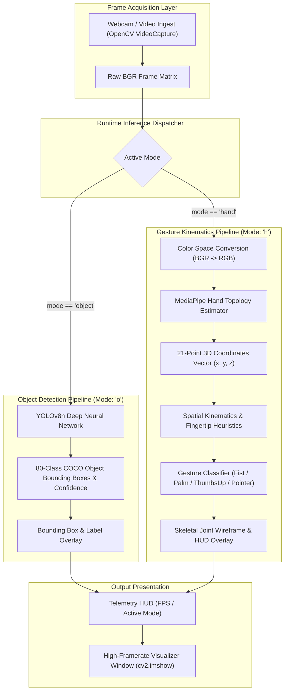

# VisionCore: Real-Time Multi-Modal Computer Vision Engine

> **Real-time edge computer vision inference pipeline combining YOLOv8 deep neural object detection with MediaPipe 21-point hand landmark kinematics and heuristic spatial gesture classification.**

[](https://www.python.org/)
[](https://opencv.org/)
[](https://github.com/ultralytics/ultralytics)
[](https://developers.google.com/mediapipe)
[](https://numpy.org/)

---

## Pitch & Executive Summary

**VisionCore** is a high-framerate, multi-modal computer vision processing engine designed for real-time edge perceptual intelligence. The system couples deep neural object localization (**YOLOv8n**) with spatial skeletal tracking (**MediaPipe Hands**), providing concurrent 80-class object identification and 21-point coordinate hand landmark tracking with low frame latency.

Designed for human-computer interaction (HCI) and visual surveillance prototypes, VisionCore incorporates an instant hotkey state machine allowing dynamic runtime toggling between deep neural object detection and kinematic gesture classification.

---

## Architecture Overview

The pipeline ingests raw BGR camera frames via hardware-accelerated **OpenCV** buffers, routing frames through an active inference mode dispatcher:



### Architectural Highlights

- **Dual-Model Inference Decoupling:** Isolates computationally heavy YOLOv8 convolutional passes from lightweight MediaPipe geometric coordinate calculations, allowing consistent 30+ FPS execution on consumer hardware.
- **21-Point Kinematic Vector Analysis:** Hand tracking extracts 21 discrete coordinate landmarks, calculating relative euclidean distance and axis differentials across finger tips (`THUMB_TIP [4]`, `INDEX_FINGER_TIP [8]`, `MIDDLE_FINGER_TIP [12]`, `RING_FINGER_TIP [16]`, `PINKY_TIP [20]`) to detect complex physical gestures without requiring training a secondary neural network.
- **Zero-Copy Matrix Manipulation:** Operates directly on NumPy ndarrays via OpenCV, minimizing memory reallocation and garbage collection overhead during active video streaming.

---

## Key Features

### 1. Deep Neural Object Detection (YOLOv8)
- Employs **YOLOv8 Nano (`yolov8n.pt`)**, optimized for low-latency inference on edge CPUs and embedded devices.
- Multi-object detection across 80 classes (people, vehicles, electronics, furniture, animals) with dynamic confidence scoring and non-maximum suppression (NMS).

### 2. Kinematic 3D Hand Landmark Tracking
- Google MediaPipe machine learning pipeline identifying palm boundaries followed by 21 3D coordinate hand landmarks.
- Spatial finger extension detection comparing fingertip coordinates against base MCP joints.

### 3. Heuristic Gesture Classification Engine
- **Open Palm:** Simultaneous extension of all 5 digits.
- **Closed Fist:** Zero extended fingers with closed fist bounding.
- **Thumbs Up:** Thumb extended outward with remaining 4 digits curled inward.
- **Index Pointer:** Single finger extension for visual pointing and UI trigger commands.

### 4. Interactive Telemetry HUD & Mode Switching
- Dynamic keyboard event bindings for seamless transitions:
  - `o`: Activate YOLOv8 object recognition.
  - `h`: Activate MediaPipe hand tracking and gesture recognition.
  - `q`: Graceful termination and camera device release.

---

## Tech Stack & Architectural Rationale

| Component | Technology | Rationale |
| :--- | :--- | :--- |
| **Object Detection** | **Ultralytics YOLOv8** | State-of-the-art anchor-free object detector with fast convergence, minimal latency, and native PyTorch / ONNX support. |
| **Landmark Tracking**| **Google MediaPipe** | Highly optimized ML pipeline capable of real-time multi-hand 3D tracking on edge CPUs without requiring discrete GPUs. |
| **Vision & Capture** | **OpenCV (cv2)** | Industry-standard cross-platform library for video I/O, color space matrix transformations, and HUD rendering. |
| **Numerical Ops** | **NumPy** | Optimized C-level multidimensional array manipulation for spatial coordinate calculations. |

---

## Repository Structure

```text
├── main.py                      # Core inference loop, gesture heuristics, and keyboard dispatcher
├── yolov8n.pt                   # Pre-trained YOLOv8 Nano PyTorch model weights (COCO 80 classes)
├── requirements.txt             # Pinned runtime dependencies (OpenCV, Ultralytics, MediaPipe)
└── README.md                    # Technical documentation and architecture specification
```

---

## Getting Started

### Prerequisites

- **Python 3.9+**
- USB Webcam or built-in camera

---

### Step 1: Clone & Configure Virtual Environment

```bash
git clone https://github.com/NURJAKS/VisionCore.git
cd VisionCore
python3 -m venv venv
source venv/bin/activate
```

---

### Step 2: Install Dependencies

```bash
pip install -r requirements.txt
```

---

### Step 3: Run Inference Pipeline

```bash
python main.py
```

### Controls

| Hotkey | Action | Description |
| :---: | :--- | :--- |
| **`o`** | Object Detection Mode | Runs YOLOv8 real-time object classification and bounding box rendering |
| **`h`** | Gesture Detection Mode | Renders MediaPipe hand skeletal graph and classifies physical hand gestures |
| **`q`** | Quit Application | Safely releases camera buffer and destroys GUI windows |

---

## Known Limitations & Production Roadmap

- **TensorRT / ONNX Runtime:** Model quantization (INT8/FP16) using TensorRT for 100+ FPS execution on NVIDIA Jetson / RTX hardware.
- **RTSP / HLS Network Stream Ingestion:** Expanding beyond local webcams to support networked IP camera streams with reconnect resilience.
- **Multi-Hand Tracking:** Extending the gesture heuristic classifier to evaluate dual-hand interactions.

---

## License

This project is licensed under the MIT License.
